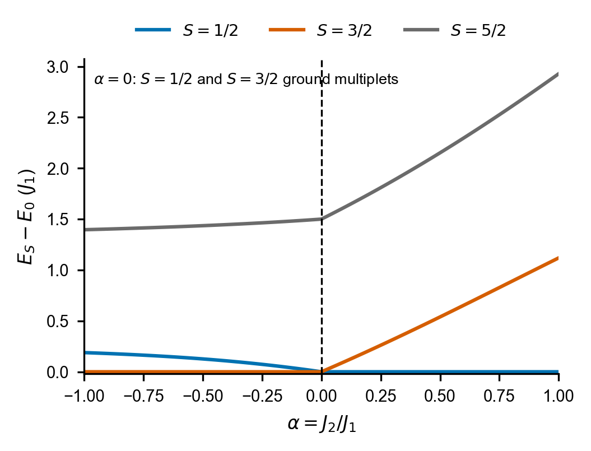
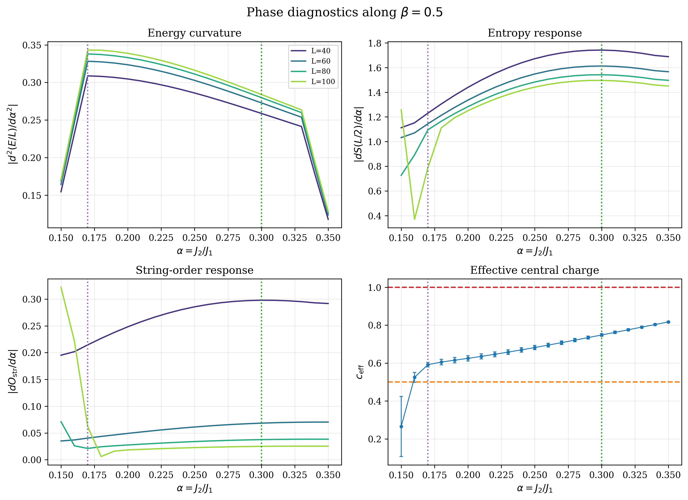
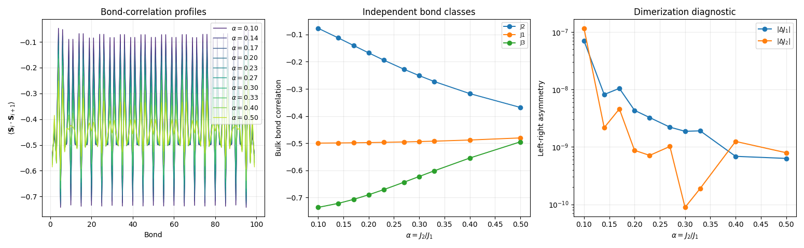
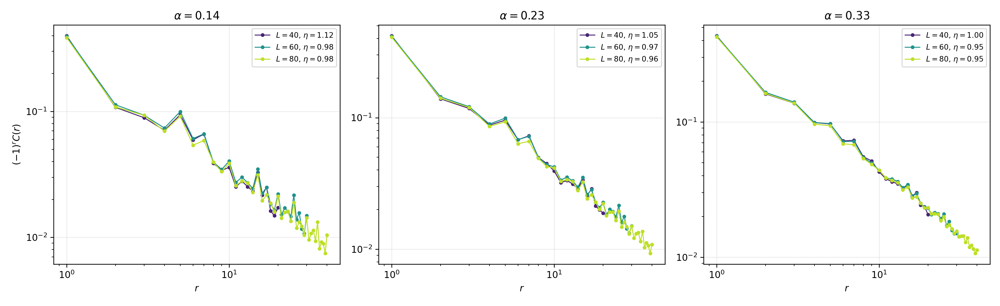
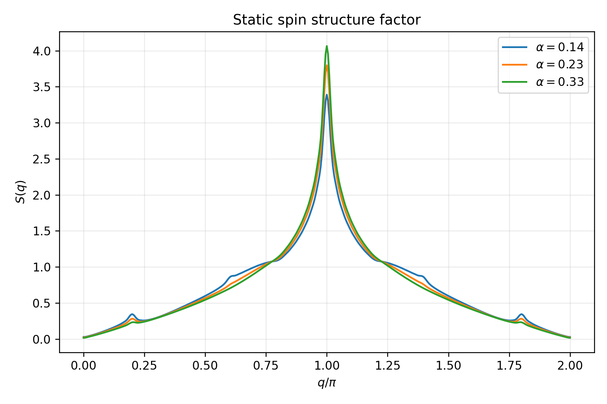
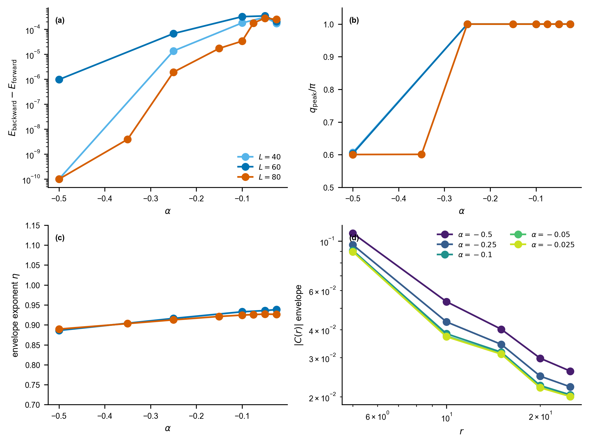
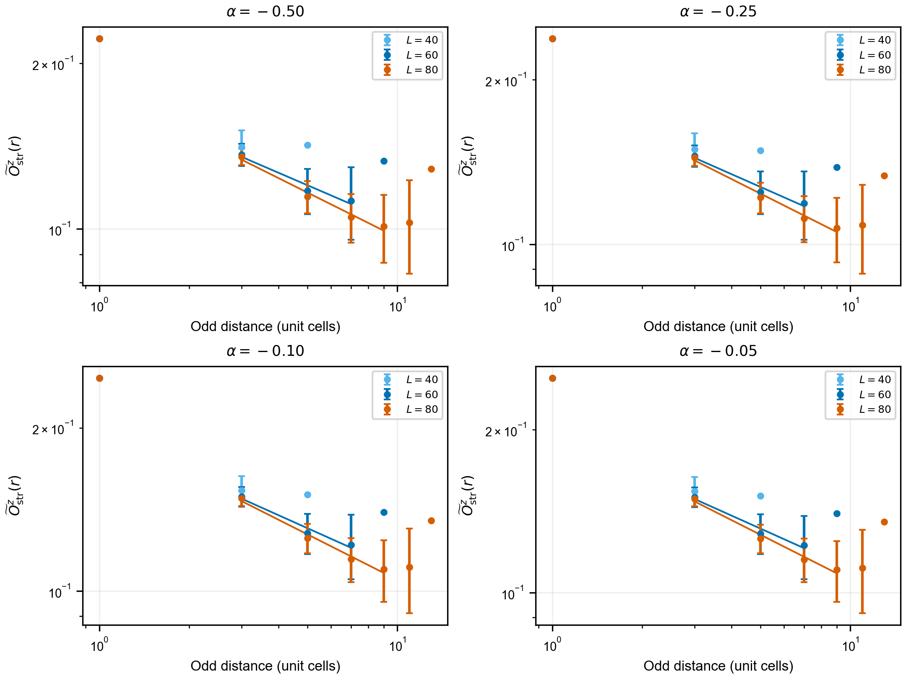
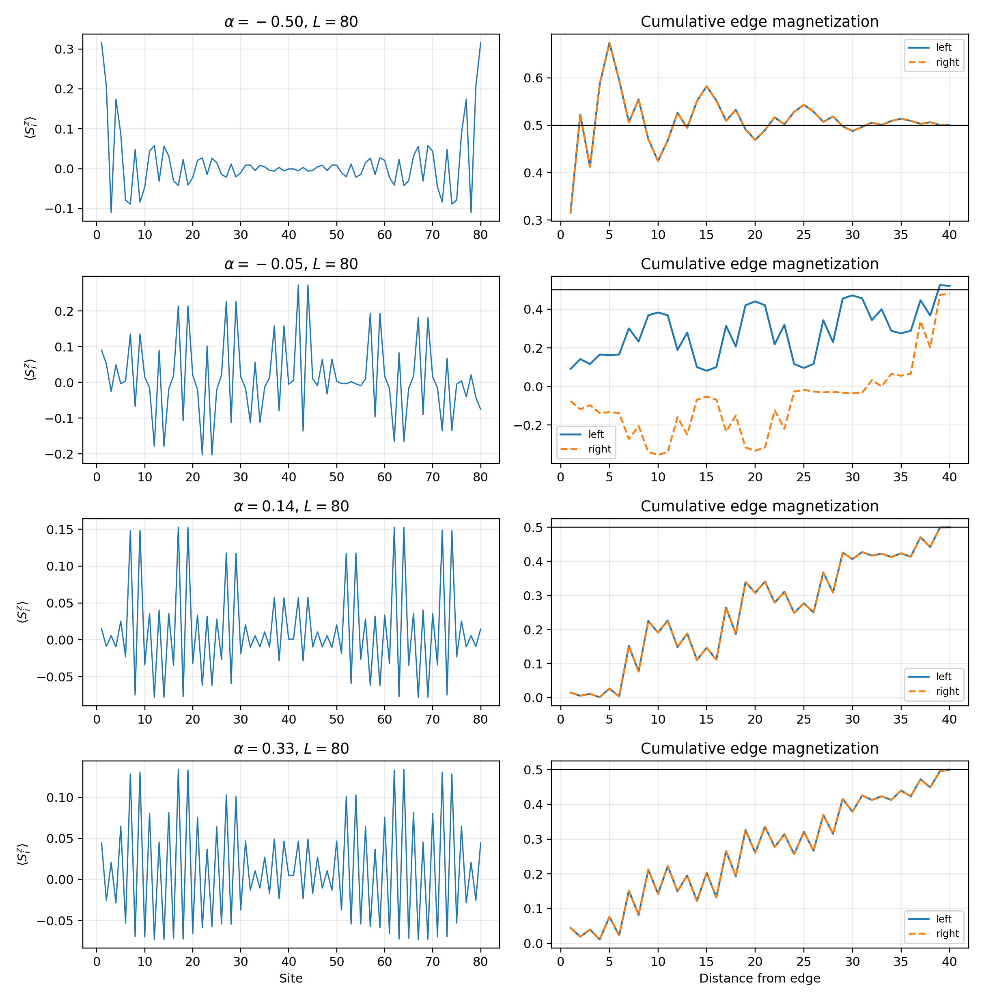
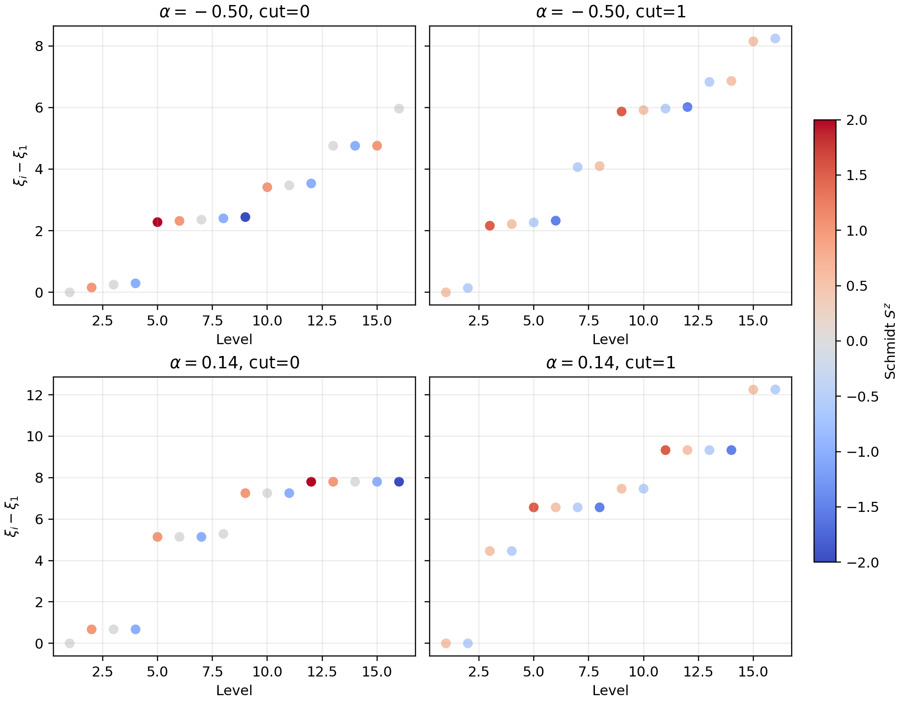
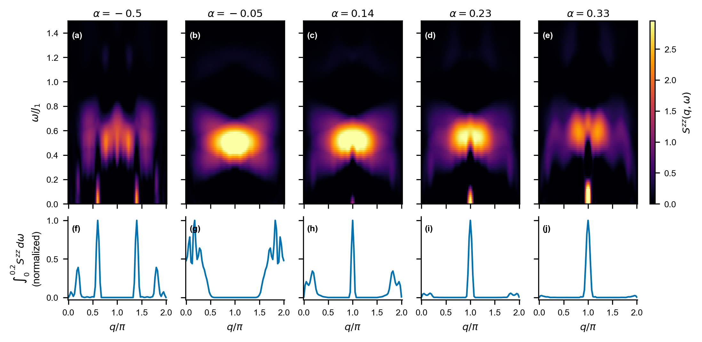

# 自旋 1/2 五聚体 Heisenberg 链初步分析

**记录日期：2026 年 7 月 23 日** 
**当前研究范围：固定 $\beta=J_3/J_1=0.5$ 的参数截面** 

***

## 一、研究对象与核心问题

本文研究具有五站点单胞的一维自旋 1/2 Heisenberg 链。每个单胞内部包含两条
$J_1$ 键和两条 $J_2$ 键，相邻单胞通过 $J_3$ 键连接。哈密顿量写为

$$
H =
J_1\sum_n
\left(
\mathbf S_{n,2}\cdot\mathbf S_{n,3}
+
\mathbf S_{n,3}\cdot\mathbf S_{n,4}
\right)
+
J_2\sum_n
\left(
\mathbf S_{n,1}\cdot\mathbf S_{n,2}
+
\mathbf S_{n,4}\cdot\mathbf S_{n,5}
\right)
+
J_3\sum_n
\mathbf S_{n,5}\cdot\mathbf S_{n+1,1}.
$$

本文以 $J_1=1$ 为能量单位，并定义

$$
\alpha=\frac{J_2}{J_1},
\qquad
\beta=\frac{J_3}{J_1}.
$$

当前先固定 $\beta=0.5$，主要检查负 $\alpha$ 区域是否为普通有隙
Haldane-like 区域、正 $\alpha$ 区域的两个响应峰是否构成额外相、
$\alpha=0$ 应如何分类，以及负侧的弦关联、边缘响应和临界体关联能否共存。

当前尚未确定最终相名，算符定义、有限尺寸拟合、DMRG 收敛与物理命名仍需检验。

***

## 二、与 Li 等四聚体工作的关系

参考工作为 Li 等发表于 npj Quantum Materials 的
*Spin order and spin excitation spectra of spin-1/2 tetramer chains*。

当前五聚体工作借用了该文献的证据组织方式，即先分析孤立单胞多重态，再计算
弦关联、边缘和纠缠结构，最后结合静态关联和动力学结构因子判断低能性质。

五聚体单胞含有奇数个自旋 1/2，因此低能约束与偶数自旋单胞的四聚体链不同。
目前没有直接照搬四聚体中的相名、弦算符端点、Haldane 相判定，也没有直接使用
triplon、quinton 或 spinon 等激发名称。

***

## 三、近期完成的工作

近期工作首先修复了孤立五聚体精确对角化中的简并态分类问题。原程序只按照能量
分类，在简并能量子空间内没有进一步对角化总自旋算符
$\mathbf S_{\mathrm{tot}}^2$，可能导致简并态总自旋量子数识别错误。修复后增加了
$\alpha=0$ 的回归测试，当前测试结果为 `54/54` 通过。

在基态分析中，完成了基态能量、弦关联、普通自旋关联、静态结构因子、自旋隙、
边缘磁化、Schmidt 权重、纠缠熵和有限尺寸标度。为了处理靠近
$\alpha=0$ 的 DMRG 路径依赖，还实现了正向和反向参数延拓。

在动力学方面，完成了五个代表参数点的试验性 TEBD 动力学结构因子，并准备了
负侧高分辨率 DSF 的服务器计算脚本。

***

## 四、孤立五聚体的低能多重态

孤立五聚体的低能多重态在 $\alpha=0$ 两侧发生明显重排。当 $\alpha<0$ 时，
最低多重态为 $S=3/2$；当 $\alpha>0$ 时，最低多重态为 $S=1/2$。
在 $\alpha=0$，两个 $S=1/2$ 多重态与一个 $S=3/2$ 多重态简并，共形成
八个孤立单胞低能态。

这一结果说明 $\alpha=0$ 是单胞低能自由度发生重组的特殊点，但孤立单胞结果
本身还不能证明整条链在该点发生普通连续量子相变。整条链在 $\alpha=0$ 是否
具有随系统尺寸增长的低能简并，以及该点应称为相界、解耦点还是多临界点，
仍需要进一步判断。

***

## 五、原始响应峰与候选中间区域

在 $\beta=0.5$ 截面中，不同观测量出现了不同位置的响应峰。基态能量曲率的
主要响应约位于 $\alpha=0.17$，纠缠响应的主要峰值约位于
$\alpha=0.30$。这两个峰最初使我怀疑两者之间可能存在一个额外的中间区域。

但是，响应峰只能说明有限尺寸下某个观测量变化较快，不能自动定义相边界。
因此后续重点检查了两峰之间的键关联、自旋隙、普通关联指数、静态结构因子和
动力学低能权重。

***

## 六、正侧键关联没有显示新的键序

在 $\alpha=0.17$ 与 $\alpha=0.30$ 之间，三类独立键关联均连续变化。
左右反射对称的 $J_1$ 键和 $J_2$ 键之间的差异保持在数值误差范围，没有观察到
稳定二聚化，也没有观察到键序突然重排。

这一结果不支持常规键序型第四相，但它不能严格排除两个不同的无隙相，也不能
排除 BKT 型转变或只在更大尺寸中显现的窄区域。

***

## 七、正侧普通关联与静态结构因子

在 $\alpha=0.14$、$0.23$ 和 $0.33$ 三个代表参数点，普通自旋关联均更符合
幂律衰减。当前拟合得到的指数约为

$$
\eta\approx0.95\text{--}0.98.
$$

指数在两个响应峰之间连续变化，没有观察到明显突变。

三个代表参数点的静态结构因子均保持单一主峰，主峰位置为 $q=\pi$。
没有观察到峰分裂，也没有观察到不公度波矢重构。

结合自旋隙有限尺寸外推接近零的结果，当前已采样的正 $\alpha$ 区域更符合一个
常规无隙反铁磁临界区域。两个响应峰目前更像观测量依赖的有限尺寸交叉尺度，
而不是额外相的两条边界。

***

## 八、靠近 alpha=0 的 DMRG 路径依赖

独立产品态初始化时，靠近 $\alpha=0$ 的负侧曾得到快速衰减的普通关联。
进一步计算发现，该状态的 DMRG 能量在较多 sweeps 后仍持续下降，而且不同
边缘初态可能得到不对称的边缘磁化分布。这说明靠近 $\alpha=0$ 时存在明显的
初始化路径依赖。

为减少该问题，我分别从深负区域和近零区域出发进行参数延拓。正向延拓从
$\alpha=-0.50$ 逐步推进到 $\alpha=-0.025$，反向延拓则从
$\alpha=-0.025$ 返回深负区域。每个新参数点都使用前一参数点收敛的 MPS
作为初态。

***

## 九、负侧双向延拓与普通关联

靠近 $\alpha=0$ 时，从深负区域延拓得到的 forward 分支能量更低。代表结果为

$$
E_{\mathrm{forward}}-E_{\mathrm{backward}}
\approx -2.8\times10^{-4},
\qquad
L=80,\ \alpha=-0.050,
$$

以及

$$
E_{\mathrm{forward}}-E_{\mathrm{backward}}
\approx -2.5\times10^{-4},
\qquad
L=80,\ \alpha=-0.025.
$$

因此原来快速衰减的 backward 分支或独立产品态分支更可能是较高能量的
假收敛态。

在能量更低的 forward 分支上，$L=60$ 和 $L=80$ 的普通自旋关联均表现为
代数衰减，当前指数约为

$$
\eta\approx0.89\text{--}0.94.
$$

这说明负 $\alpha$ 区域不能简单解释为普通有限关联长度的有隙 Haldane-like
体态。

目前 forward 分支只是最可信的低能候选。现阶段还没有系统完成能量方差、
多随机 MPS 初态和最大键维数外推，因此还不能把它称为已经严格证明的全局基态。

***

## 十、负侧主导动量的变化

负侧普通关联的动量分析显示，深负区域的主要波矢接近

$$
q_{\mathrm{peak}}\approx\frac{3\pi}{5},
$$

而靠近 $\alpha=0$ 时主要波矢转向

$$
q_{\mathrm{peak}}\approx\pi.
$$

当前大致观察到

| 参数范围 | 主导波矢 |
|---|---|
| $\alpha\le-0.35$ | $q_{\mathrm{peak}}\approx3\pi/5$ |
| $\alpha\ge-0.25$ | $q_{\mathrm{peak}}\approx\pi$ |

普通关联指数在该位置没有明显突变，正向和反向延拓能量也没有形成稳定滞后。
因此目前只将该现象描述为动量重分配或候选 Lifshitz 尺度，而不把
$\alpha\approx-0.3$ 列为独立相界。

***

## 十一、负侧低能分支上的弦关联

弦关联在 deep-negative forward 分支的低能 MPS 上重新计算。当前分析的参数点为
$\alpha=-0.50$、$-0.25$、$-0.10$ 和 $-0.05$，系统尺寸为
$L=40$、$60$ 和 $80$。

采用的弦关联形式为
$O_{\mathrm{str}}^z(i,j)=-\langle S_i^z
\exp(i\pi\sum_{k=i+1}^{j-1}S_k^z)S_j^z\rangle$。

当前选择跨越五聚体单胞边界的格点作为端点，并分析奇数位胞距离的交错包络。
为了减少短距离结构和开放边界最长距离回升的影响，拟合窗口采用

$$
3\le d\le\frac{2N}{3}.
$$

在 $L=60$ 和 $L=80$ 的四个负 $\alpha$ 参数点中，幂律模型均优于指数模型
和纯常数模型。得到的弦关联指数约为

$$
\eta_{\mathrm{str}}\approx0.23\text{--}0.25,
\qquad L=60,
$$

以及

$$
\eta_{\mathrm{str}}\approx0.27\text{--}0.28,
\qquad L=80.
$$

当前结果说明负侧弦关联不是普通快速指数衰减，而是在临界体关联背景上保持明显
更慢的衰减。

但是，$L=60$ 的拟合窗口内只有约三个有效距离点，$L=80$ 只有约四个有效
距离点。因此当前指数主要用于区分慢衰减与快速指数衰减，不能视为高精度临界
指数，也不能排除更大尺寸后趋向有限常数。

***

## 十二、负侧边缘磁化

在总 $S^z=1$ 扇区中，负侧额外磁化主要集中在开放链两端。固定取左右各十个
格点时，边缘权重随尺寸的结果为

| 系统尺寸 | 左右十格点总边缘权重 |
|---|---|
| $L=40$ | $0.879$ |
| $L=60$ | $0.858$ |
| $L=80$ | $0.849$ |

该固定宽度边缘权重随尺寸变化较慢，而正侧代表参数点的相同边缘权重随尺寸下降
更明显。这说明负侧存在局域边缘自由度的数值迹象。

开放边界下的边缘磁化不能单独证明拓扑相。边缘响应也可能与基态简并或对称性
破缺有关，因此还需要与纠缠谱和虚空间对称性表示交叉验证。

***

## 十三、负侧纠缠谱

负侧单胞边界切割中出现特殊的低能 Schmidt 权重簇，该低能结构与边缘多重态
图像相容。弦关联、边缘磁化和 Schmidt 低能簇共同支持负侧具有非平庸边缘和
纠缠结构。

但是，SU(2) 多重态本身也可能产生 Schmidt 权重简并，仅凭纠缠谱简并不能
宣布 Haldane 相或 gapless SPT。当前仍缺少 MPS 虚空间上的投影对称表示。

***

## 十四、试验性动力学结构因子

当前本地试验谱使用 $\beta=0.5$、$L=40$、时间步长 $dt=0.05$ 和
$t_{\max}=15$。代表参数点为 $\alpha=-0.50$、$-0.05$、$0.14$、
$0.23$ 和 $0.33$。

在 $\alpha=-0.50$ 时，较强低频权重位于 $q\approx3\pi/5$ 附近。
靠近零点的负侧低频权重向 $q=\pi$ 转移。正侧三个代表参数点的低频权重主要
位于 $q=\pi$，两个响应峰之间没有观察到明显的谱动量重构。

由于当前系统尺寸较小且总演化时间较短，该谱只用于识别主要低频权重位置，
不能用于精确提取能隙、连续谱边界或准粒子类型。

***

## 十五、当前初步物理图像

**负 $\alpha$ 区域**

该区域表现出代数普通关联、缓慢弦关联、边缘磁化和特殊 Schmidt 低能簇。
当前最安全的描述是“具有弦和边缘特征的临界区域”。

**$\alpha=0$**

该点在孤立单胞中具有八重低能简并，两侧最低多重态发生重组。当前最安全的描述
是“特殊解耦点或低能自由度重组点”。

**正 $\alpha$ 区域**

该区域的自旋隙外推接近零，普通关联为幂律，主导波矢保持 $q=\pi$。当前最安全
的描述是“常规无隙反铁磁临界区域”。

负侧可能与 gapless SPT-like 区域有关，但该名称目前只作为候选解释。
正侧两个响应峰目前不构成额外相的闭合证据链。负侧
$3\pi/5\rightarrow\pi$ 的变化目前只作为动量重分配处理。

***

## 十六、当前结论的证据边界

**关于 $\alpha=0$**

当前较可靠的判断是该点属于孤立单胞低能自由度重组点。现阶段不能直接写成
“已经证明为普通连续量子相变点”。

**关于负侧临界性**

当前较可靠的判断是低能分支的普通关联不是快速指数衰减。现阶段不能直接写成
“已经严格证明为 gapless SPT”。

**关于负侧弦关联**

当前较可靠的判断是弦关联在现有尺寸下明显慢于普通关联。现阶段不能直接写成
“已经具有严格非零长程弦序”。

**关于边缘和纠缠结构**

当前较可靠的判断是负侧具有局域边缘响应和特殊纠缠低能簇。现阶段不能把这些
现象直接等同于完整拓扑不变量。

**关于正侧第四相**

当前较可靠的判断是代表参数点均保持以 $q=\pi$ 为主的幂律关联。现阶段只能说
“没有发现第四相证据”，不能说“数学上绝对不存在第四相”。

**关于负侧动量变化**

当前较可靠的判断是主导动量发生重分配。现阶段不能直接写成
“$\alpha\approx-0.3$ 已经证明是 Lifshitz 相变”。

**关于动力学激发**

试验性 DSF 只能给出低频权重的大致位置，现阶段不能据此确认解禁闭 spinon
或其他准粒子类型。

***

## 十七、待检验的问题

## 弦关联定义和端点

**当前做法**

当前使用格点自旋作为弦关联端点，端点跨越五聚体单胞边界，并分析奇数位胞距离
的交错包络。

**可能问题**

五聚体单胞含有奇数个自旋 1/2，Li 等四聚体模型中的弦端点和拓扑解释不一定
能够直接移植。当前端点选择尚未与明确的保护对称性建立对应关系。

**待检验问题**

五聚体模型应该使用单个格点自旋还是单胞总自旋作为弦端点？端点是否应该跨越
$J_3$ 胞间键？当前奇数位胞距离的交错符号是否正确？是否需要同时比较多种
弦算符？

***

## 奇数半整数单胞与有隙相

每个五聚体单胞包含的自旋总量为

$$
5\times\frac12=\frac52.
$$

**可能问题**

半奇整数单胞可能受到 Lieb-Schultz-Mattis 类型约束，唯一、平移对称且保持
自旋旋转对称性的普通有隙基态可能不被允许。

**待检验问题**

负侧是否理论上就不适合解释为普通有隙 Haldane-like 相？是否必须进一步检查
平移对称性自发破缺或基态简并？负侧边缘响应是否可能来自对称性破缺而不是
SPT？

***

## alpha=0 的物理分类

**当前做法**

当前将 $\alpha=0$ 称为特殊解耦点或低能自由度重组点。

**可能问题**

孤立五聚体八重简并不能直接说明整条链是普通临界点。在 $\alpha=0$ 时，模型
可能分解成二聚体和三聚体结构，并产生大量低能自由度。

**待检验问题**

$\alpha=0$ 应称为普通量子临界点、广延简并解耦点还是多临界点？是否可以把
它视为两个不同临界区域之间的相界？是否应该优先推导该点的有效低能模型？

***

## DMRG forward 分支的可靠性

**当前依据**

forward 分支在靠近 $\alpha=0$ 时能量更低，并在多个系统尺寸中保持代数普通
关联。

**尚未完成**

目前没有系统完成能量方差、多随机初态、最大键维数外推和 MPS overlap 检查。

**待检验问题**

当前证据是否足以把 forward 分支作为基态候选继续分析？正式写作前是否必须补
能量方差和多初态收敛？应优先检查哪一种收敛指标？

***

## 普通关联包络提取

**当前做法**

当前在每五个格点窗口中选取一次 $|C(r)|$ 的局域最大值，用于构造五聚体振荡
包络。

**可能问题**

局域最大值可能高估关联强度，也可能掩盖多个波矢分量。开放边界下直接用距离
$r$ 拟合还可能产生有限尺寸偏差。

**待检验问题**

是否应该改用固定中心端点、带 $\cos(qr+\phi)$ 的直接振荡拟合、单胞总自旋
关联，或使用 chord distance
$d_{\mathrm{chord}}=(L/\pi)\sin(\pi r/L)$？

***

## 弦关联拟合点数

**当前情况**

$L=60$ 的体区拟合只有约三个有效距离点，$L=80$ 只有约四个有效距离点。

**可能问题**

虽然幂律模型优于指数模型，但当前点数不足以高精度确定临界指数，也不能可靠
排除带有限常数项的形式
$O_{\mathrm{str}}(r)=O_{\infty}+Ar^{-\eta}$。

**待检验问题**

当前是否只能写成“排除快速指数衰减”？是否可以报告
$\eta_{\mathrm{str}}\approx0.23\text{--}0.28$？是否必须先计算
$L=120$ 和 $L=160$？

***

## 负侧动量重分配

**当前现象**

主导波矢由深负区域的 $3\pi/5$ 转向靠近零点的 $\pi$。

**可能问题**

该变化可能受到五站点单胞动量折叠、开放边界和有限尺寸的影响，也可能只是
不同波矢分量之间的谱权重转移。

**待检验问题**

该结果应该在原始还是折叠 Brillouin zone 中表示？是否应该使用完整静态结构
因子或 OBC sine transform 重新确认？需要什么额外证据才能称为 Lifshitz
transition？

***

## 正侧第四相

**当前证据**

两个响应峰之间没有观察到有限能隙、二聚化、键序重排、主导波矢改变或普通关联
指数突变。

**可能问题**

这些局域和有限尺寸观测量仍不能严格排除两个不同无隙相之间的 BKT 型或拓扑型
转变。

**待检验问题**

下一步应优先计算中心荷、Luttinger 参数、level spectroscopy、twisted
boundary conditions、虚空间投影对称表示，还是更大尺寸的纠缠熵？

***

## 十八、下一步计算路线

**基态可靠性路线**

该路线补充能量方差、多随机初态、最大键维数外推和更大尺寸普通关联，用于判断
forward 分支是否为可靠基态。

**临界普适类路线**

该路线补充中心荷、chord-distance 拟合、Luttinger 参数和 level
spectroscopy，用于判断 $\alpha=0$ 两侧是否属于不同的临界区域。

**拓扑性质路线**

该路线比较不同弦端点，计算虚空间投影对称表示和扭曲边界条件，用于判断负侧
能否称为 gapless SPT。

**动力学证据路线**

该路线计算更大 $L$ 和更长 $t_{\max}$ 的动力学结构因子，用于确认低能模式、
动量重分配和连续谱结构。

当前已经准备的服务器 DSF 参数为

| 参数 | 数值 |
|---|---|
| $\alpha$ | $-0.50,\ -0.10,\ -0.05,\ 0.23$ |
| $\beta$ | $0.5$ |
| $L$ | $80$ |
| $dt$ | $0.05$ |
| $t_{\max}$ | $30$ |

该任务用于验证深负区域的 $q\approx3\pi/5$ 低能模式、近零负侧的
$q=\pi$ 低能模式，并以正侧 $\alpha=0.23$ 作为对照。

***

## 十九、当前最保守的总结

在固定 $\beta=0.5$ 的有限尺寸结果中，$\alpha=0$ 是孤立单胞低能多重态
发生重组的特殊解耦点。负 $\alpha$ 低能分支具有代数普通关联，而不是普通
短程有隙体态，同时还表现出缓慢弦关联、局域边缘磁化和特殊 Schmidt 低能簇。
正 $\alpha$ 代表参数点表现为以 $q=\pi$ 为主的无隙反铁磁关联，正侧两个响应峰
目前没有构成独立相的闭合证据链。

当前最安全的相结构描述为

| 区域 | 暂定描述 |
|---|---|
| 负 $\alpha$ | 具有弦和边缘特征的临界区域 |
| $\alpha=0$ | 特殊解耦点或低能自由度重组点 |
| 正 $\alpha$ | 常规无隙反铁磁临界区域 |

gapless SPT、Lifshitz 相变、解禁闭自旋子和完整二维相图仍需要后续验证。

***

## 二十、开放问题

尚需检验当前弦关联端点是否合理，负侧临界性的证据是否可信，
DMRG 是否必须先补能量方差，$\alpha=0$ 应如何命名，
$3\pi/5\rightarrow\pi$ 应如何解释，以及排除正侧第四相最优先需要补充哪一种
普适量或拓扑诊断。

上述结论均为当前有限尺寸数据下的初步解释。
