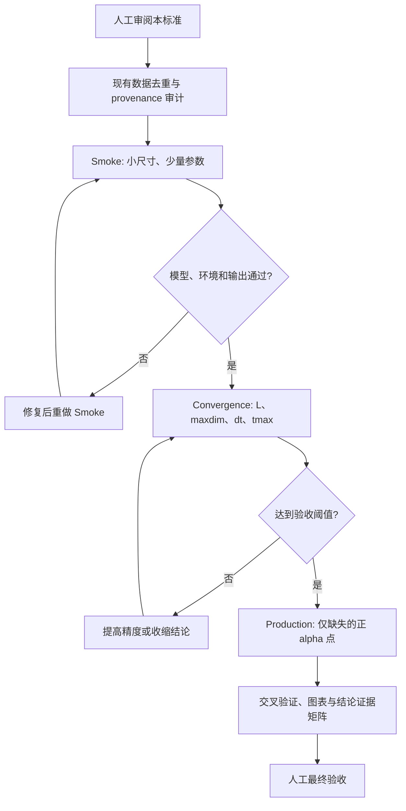

# 1x5 Heisenberg 五聚体链复现计算标准

> 状态：`APPROVED v1.2`，课题负责人于 2026-07-29 批准；2026-07-30 补充纠缠和局域谱权验收规则。  
> 生效范围：本项目后续新增计算、服务器任务、数据验收和论文图表。  
> 参考论文：Li et al., *Spin order and spin excitation spectra of spin-1/2 tetramer chains*, npj Quantum Materials **11**, 37 (2026), DOI: `10.1038/s41535-026-00855-x`。

## 1. 目标与边界

本项目复现参考论文的研究逻辑和主要数值证据，但将每个单胞从四个自旋 `1/2` 格点改为五个格点。新计算只研究

```text
0 <= alpha <= 1,  0 <= beta <= 1,  J1 = 1
```

其中 `alpha = J2/J1`，`beta = J3/J1`。`alpha = 0` 是必须保留的特殊解耦点，不属于负 `alpha` 区域。

以下内容不在当前范围内：

- 不新增、不补算、不扩展任何 `alpha < 0` 的数据。
- 不继续参考论文中依赖铁磁 `J2` 的 CuInVO5 材料路径。
- 不把四聚体论文中的 tetramer、Haldane、triplon、quarton 或 quinton 名称直接移植到五聚体。
- 不以单一弦序参量、单一有限尺寸峰或一张谱图宣告新相。
- 在本标准经人工审阅前，不提交生产级扫描或长时间动力学任务。

历史负 `alpha` 数据和脚本保留作项目档案，但不得进入新的任务矩阵、拟合、论文主结论或服务器提交列表。

## 2. 模型契约

第 `n` 个五聚体包含格点 `5n-4,...,5n`。开边界 Hamiltonian 固定为

```math
H = \sum_{n=1}^{N}
\left[
J_2(\mathbf S_{5n-4}\cdot\mathbf S_{5n-3}
   +\mathbf S_{5n-1}\cdot\mathbf S_{5n})
+J_1(\mathbf S_{5n-3}\cdot\mathbf S_{5n-2}
   +\mathbf S_{5n-2}\cdot\mathbf S_{5n-1})
\right]
+J_3\sum_{n=1}^{N-1}\mathbf S_{5n}\cdot\mathbf S_{5n+1}.
```

采用 `J1 = 1`、`J2 = alpha`、`J3 = beta`。任何脚本、数据表和图注都必须同时写出 `alpha`、`beta`、单胞数 `N_units`、总格点数 `L=5*N_units`、边界条件和自旋扇区。

参考论文使用 16 个四聚体，即 `L=64`。五聚体的直接等单胞对应是 16 个五聚体，即 `L=80`，因此 `L=80` 是默认生产尺寸，不是热力学极限。

五个自旋 `1/2` 使每个单胞携带半整数总自旋。只要平移和 SU(2) 对称性保持，LSM 型约束禁止热力学极限中出现唯一、对称且完全有隙的基态。因此：

- 四聚体相图的相名不能按图形位置复制。
- 有限开链在偶数单胞时可处于 `Sz=0`，这不等价于热力学极限的唯一有隙相。
- 相的命名必须联合能隙、关联、纠缠、边缘响应和动力学证据。

## 3. 项目现状与复用规则

### 3.1 已完成资产

| 资产 | 当前覆盖 | 使用结论 |
|---|---|---|
| 单五聚体 ED、总自旋多重态、能级图 | 单胞 32 维空间 | 可直接复用；正式图只截取 `alpha>=0` |
| `phase_diagram_80x60_hires.csv` | 80×60，含正负 `alpha` | 仅作选点地图；正半区可复用，不作为最终相界证据 |
| 键关联 | `beta=0.5`，多个正 `alpha`，`L=100` | 可复用，先核对运行参数与收敛记录 |
| 自旋隙 | `beta=0.5`，正 `alpha`，`L=40,60,80` | 可复用作有限尺寸基线 |
| 静态结构因子和实空间关联 | `alpha=0.14,0.23,0.33` 等正侧点 | 可复用作正侧波矢与幂律诊断 |
| 纠缠剖面与部分纠缠谱 | 正侧代表点，最高到 `L=100`/`L=80` | 可复用，缺失的收敛元数据需补审计 |
| 正侧 TEBD DSF | `alpha=1`，`beta=0.1,0.4,0.5,0.7,1.0` | 热图可用于侦察；多数点缺原始时域数据和完整 provenance |
| 正侧 DSF pilot | `alpha=0.14,0.23,0.33`，`beta=0.5`，`L=40,tmax=15` | 原始时域数据存在，可作为收敛和选点起点 |

### 3.2 已知数据质量问题

- `data/phase_diagram_80x60_hires.csv` 有 4,974 行、4,800 个唯一参数点和 174 行重复记录。
- `alpha_001.csv`、`alpha_021.csv`、`alpha_080.csv` 各有 118 行，预期应为 60 行。
- 高分辨率相图只记录 `alpha,beta,O_str,energy`，缺少能量方差、截断误差、实际最大键维数和运行清单。
- 旧文档中的 `45` 项测试记录已过时；2026-07-29 本地与服务器实测均为 `54/54`。
- 仅有最终 `S(q,omega)` CSV、没有原始 `C(r,t)` 与傅里叶参数的谱图，不能通过生产验收。

### 3.3 禁止重复计算

每个新任务在提交前必须按 `(method, alpha, beta, L, sector, observable, numerical knobs)` 查询现有 CSV/JLD2 和任务日志。

- 完全匹配且通过本标准的结果：直接复用。
- 物理点匹配但缺 provenance：只补最小验证点，不整批重算。
- 只有图、没有原始数据：图只能作侦察证据。
- 参数或算法精度不同：作为收敛序列的一部分保留，不覆盖旧文件。
- 输出文件存在时默认跳过；只有明确设置 `FORCE_RECOMPUTE=1` 且任务清单说明原因时才允许覆盖逻辑，实际文件仍应写入新 run 目录。

## 4. 技能路由

技能只按本项目作用域管理，不从全局目录删除，以免影响其他项目。

| 状态 | Skills | 用途 |
|---|---|---|
| 保留 | `solve`, `quantum-model`, `physics` | 模型和物理问题路由 |
| 保留 | `method-ed`, `method-mps`, `using-itensors` | 单胞 ED、有限链 DMRG/TEBD |
| 保留 | `parameter-scan`, `scaling-fit`, `cross-method-check`, `solvable` | 扫描、有限尺寸、独立验证和精确极限 |
| 保留 | `setup-cluster`, `using-slurm`, `cluster-jobs`, `setup-julia`, `build-apptainer-image` | 服务器、资源护栏和离线环境后备方案 |
| 保留 | `find-docs`, `report` | API 核对和结果报告 |
| 本项目禁用 | `method-ltrg` | 当前任务不计算有限温热力学 |
| 本项目禁用 | `using-mpskit` | 当前代码采用有限 OBC ITensorMPS，不采用无限 MPS |
| 本项目禁用 | `using-xdiag` | 单五聚体已有自编 32×32 ED，不新增 XDiag 依赖 |

若研究目标改变，必须先修改本表和方法理由，不能在任务中临时切换方法。

## 5. 计算方法原则

### 5.1 ED

- 单五聚体使用完整 32 维 Hilbert 空间，不做截断。
- 同时对角化或分类 `H` 与 `S^2`，报告能量、总自旋和简并度。
- 必检极限：`alpha=0` 的孤立自旋加三聚体结构，以及 `alpha=1` 的均匀五格点开链。
- 激发命名必须来自五聚体多重态和算符选择定则，不能沿用四聚体命名。
- 单自旋谱权必须使用固定 `(能量, S, 反射宇称)` 子空间投影器计算，不得依赖简并本征矢的任意基。
- `S^z(q)` 分析必须报告五个正交单胞动量的总谱权和规则，并检查 `q=0` 守恒、`q=pi` 宇称筛选和 `S=5/2` 秩一暗态。

### 5.2 基态 DMRG

- 使用 OBC、守恒总 `Sz`，偶数单胞的基态默认在 `Sz=0` 扇区。
- 生产基线为 `N_units=16, L=80, maxdim>=800, cutoff<=1e-8`；困难点应提高到 `maxdim=1500` 或更高并做收敛对照。
- 键维数采用逐 sweep 增长，噪声只能用于早期 sweep，最终 sweep 必须为零噪声。
- 不能以输入的 `cutoff` 代替实际截断误差；必须同时记录实际最大键维数、全 sweep 最大 discarded weight、最终三个无噪声 sweep 的最大 discarded weight、能量变化和方差。生产门槛只使用最终无噪声 sweep，预热误差仅作审计证据。
- 在候选边界和近简并点至少使用两个不同初态或双向 continuation，比较能量和观测量。

### 5.3 能隙、关联和弦序

- 自旋隙定义为同一 Hamiltonian、同一尺寸下 `Delta_s=E0(Sz=1)-E0(Sz=0)`。
- 能隙结论至少使用三个尺寸，当前标准序列为 `L=40,60,80`；临界外推有争议时加入 `L=100` 或更大。
- 普通关联必须报告实空间距离、奇偶/五格点调制和拟合窗口，不能只报告一个指数。
- 弦序端点使用五聚体边界定义，必须同时给出 `O_str(r)` 距离剖面和边界 margin。
- 非零短程弦关联不是相的充分证据；常数、幂律和指数拟合必须比较残差和信息准则。

### 5.4 纠缠

- 纠缠熵必须报告切口位置及 `bond mod 5`，避免把单胞内振荡误认为尺度行为。
- 中心荷拟合至少使用三个尺寸，并明确 OBC CFT 公式、拟合窗口和残差。
- 纠缠谱记录 Schmidt 权重、纠缠能、`Sz` 量子数和五类中心切口。
- 简并只在数值分裂随 `L` 和 `maxdim` 稳定后才可作为对称性证据。

### 5.5 修正向量 DSF

- 固定定义 `Szz(q,omega)`、Fourier 归一化、OBC 窗函数和被丢弃的边界格点。
- 与参考论文比较时默认 `eta=0.1 J1`；改变 `eta` 必须成组给出，不得用更大展宽隐藏未收敛结构。
- 每个 `(q,omega)` 点保留线性求解残差或等价收敛量，支持 checkpoint 和逐 q 恢复。
- `q=0` 守恒、`q` 反演对称和谱非负性是强制检查。

#### 5.5.1 已通过的 CV 预标定

`L=10` 固定 `Sz=0` 精确谱 oracle 已逐点验证 61 个频率点。CV 与精确谱的
相对 `L2` 误差为 `8.52e-12`，积分权重相对误差为 `7.80e-13`，最大线性
方程相对残差为 `5.82e-7`。

`L=20, alpha=0.23, beta=0.5, q=pi, omega=0.2, eta=0.1` 的截断序列为：

| CV cutoff | 输入最大维数 | 实际解维数 | 相对残差 | `S(pi,0.2)` | 验收 |
|---:|---:|---:|---:|---:|---|
| `1e-10` | 200 | 50 | `3.80e-4` | `0.900795986` | 未通过 |
| `1e-12` | 300 | 72 | `4.67e-5` | `0.900798419` | 未通过 |
| `1e-14` | 400 | 106 | `5.62e-6` | `0.900798398` | 通过 |

三档残差单调改善 `67.55` 倍，最紧两档谱强度相对差为 `2.33e-8`。当前
较大尺寸起始基线为基态 DMRG cutoff `1e-10`、CV cutoff `1e-14`；输入
`maxdim` 只是上限，成本评估和验收必须使用实际解维数。

相同物理点的 `L=40` 探针得到相对残差 `7.48e-6`、实际解维数 `256`、
峰值 RSS `1.50 GiB` 和 CV 时间 `2536.65 s`。从 `L=20` 到 `40` 的时间倍率
为 `16.81`，一次外推的 `L=80` 困难冷启动频率点约需 `11.84 h`。因此，
不得直接提交 `L=80` 频率网格；必须先通过跨进程 checkpoint 恢复和相邻频率
warm-start 成本验收。

#### 5.5.2 生产实现门槛

- 同一 `(alpha,beta,L)` 的基态 MPS 只生成一次，后续 `q` cell 从只读缓存加载。
- 每个频率点完成后写入独立 checkpoint，并原子更新索引；断线后从最后一个完整点恢复。
- 已存在且校验通过的频率点默认跳过，恢复任务不得覆盖旧点。
- 主计算只覆盖一个独立动量半区；至少选择两个非自反动量显式计算镜像伙伴进行验收。
- `q=0` 必须先检查源态范数和非弹性权重，不得用色标掩盖数值噪声。
- 每个谱面保存原始强度、残差、实际键维、求解时间和完整 Fourier 定义。

### 5.6 TEBD DSF

- 保留完整原始 `C(r,t)` JLD2、基态能量、中心格点、时间步长、总时间、截断阈值和每步最大键维数。
- 生产结果必须比较 `dt` 与 `dt/2`，并比较至少两个 `tmax` 或窗函数设置。
- Fourier 变换必须记录空间/时间窗、零填充、频率网格和等效展宽。
- 至少在一个正 `alpha` 代表点与修正向量法交叉检查。
- 现有 `200×400` 热图如果缺少原始时域数据，只能用于选点。

## 6. 三阶段运行与工作流



### Stage A：Smoke

- 目的：验证模型、扇区、离线环境、文件命名、checkpoint 和资源测量。
- 建议：`L=20` 或 `40`，`maxdim=100-200`，6-8 sweeps；只选 `alpha=0,0.2,1` 和一个 `beta`。
- Smoke 数据放入独立 run 目录，永不混入生产数据。
- 每个独立任务只执行一次 Smoke；通过后不得用相同配置反复测试。

### Stage B：Convergence

- DMRG：比较至少三档 `maxdim`，并做 `L=40,60,80` 尺度序列。
- TEBD：比较 `dt`/`dt/2`、至少两档 `maxdim` 和至少两档 `tmax`。
- 先在 `beta=0.5` 的已有正侧代表点上定精度，再扩展其他 `beta`。
- 用一次实测 wall time 和内存估计完整任务成本，禁止凭经验直接开大数组。

### Stage C：Production

- 只提交“复用矩阵”中缺失或未达标的单元。
- 每个任务有唯一 `run_id`，代码和数据只追加，不覆盖历史结果。
- 直连服务器一次只跑一个重任务；未经确认不并行多个 DMRG/TEBD 进程。
- 每完成一个参数点立即校验并同步回本地，服务器不作为唯一副本。

## 7. 运行清单与可复现性

每个 run 目录至少包含：

```text
run.json                 机器可读运行清单
stdout.log               完整标准输出
stderr.log               完整错误输出
status.json              started/running/completed/failed
results/                 原始数值结果
checksums.sha256         结果文件校验值
```

`run.json` 必须记录：

- `run_id`、开始/结束时间、主机名、操作者。
- Git commit、dirty 状态和源码 SHA-256；dirty 状态必须列出变更文件。
- Julia 版本、`Project.toml` 与 `Manifest.toml` SHA-256、包状态。
- Hamiltonian 参数、边界条件、`N_units`、`L`、总 `Sz`。
- 方法、初态、随机种子、sweep 调度、实际键维数和截断记录。
- TEBD 的 `dt,tmax`、窗函数；CV 的 `eta,q,omega` 网格和求解残差。
- CPU 线程数、峰值 RSS、算法 wall time；Julia JIT、环境初始化和绘图时间另记，不混入算法计时。

原始数据、处理后数据和绘图文件必须分目录保存。任何绘图脚本不得修改原始数据。

## 8. 数值验收规则

### 8.1 基础门槛

| 项目 | 通过条件 |
|---|---|
| 单元测试 | `54/54` 通过 |
| ED Hermiticity | `norm(H-H') <= 1e-12` |
| ED 完备性 | 多重态总简并度为 32，`S=1/2,3/2,5/2` 分类完整 |
| 解析极限 | `alpha=0` 基态能量 `-1`；`alpha=1` 基态能量约 `-1.92789` |
| 数据完整性 | 无 NaN/Inf；主键无重复；行数与任务网格一致 |
| 可追溯性 | 清单、日志、原始数据和 SHA-256 齐全 |

### 8.2 ED 局域谱权验收

| 项目 | 通过条件 |
|---|---|
| 投影完整性 | `5` 个 `S=1/2`、`4` 个 `S=3/2`、`1` 个 `S=5/2` 多重态，总维数 `32` |
| 对称性 | `norm([H,S^2])`、`norm([H,R])` 均 `<=1e-12` |
| 动量和规则 | `q=0,2pi/5,4pi/5,6pi/5,8pi/5` 上完整谱权和为 `5/4`，误差 `<=1e-12` |
| 守恒与宇称 | `q=0` 非弹性权重 `<=1e-12`；`q=pi` 错宇称权重 `<=1e-12` |
| 秩一选择定则 | `S=1/2 -> S=5/2` 权重比例 `<=1e-12` |
| 外部锚点 | `alpha=1` 全部十个多重态能量与解析/已审计值误差 `<=1e-9`，并与旧三点结果交叉核对 |

局域选择定则只能作为有限 `beta` 链 DSF 的分支先验；不能把孤立单胞间隙直接当作长链色散，必须由生产级 DSF 的尺寸、时间步和窗口检查确认。

### 8.3 DMRG 生产验收

| 项目 | 通过条件 |
|---|---|
| 能量方差 | `(<H^2>-<H>^2)/L <= 1e-8 J1^2` |
| 键维收敛 | 最高两档 `maxdim` 的能量密度差 `<=1e-6 J1` |
| 观测量收敛 | 关键无量纲观测量相对差 `<=2%`，接近零时同时报告绝对差 |
| 截断 | 最终三个无噪声 sweep 的最大 discarded weight `<=1e-9`；全 sweep 最大值必须留档，若无法记录则不通过生产验收 |
| 初态稳定性 | 代表点两初态能量密度差 `<=1e-7 J1`，否则保留多分支 |
| 有限尺寸 | 相界、能隙或指数结论至少三个尺寸，并报告拟合不确定度 |

若关键点实际键维数持续触顶，即使能量变化很小也必须追加一档 `maxdim` 或降低结论强度。

### 8.4 动力学验收

| 项目 | 通过条件 |
|---|---|
| 非负性 | `min S >= -1e-10 * max(S)` |
| `q=0` 守恒 | 非弹性权重 `<=1e-6` 倍全谱最大值 |
| 反演对称 | 对称动量切片相对 RMS 差 `<=2%` |
| TEBD 时间步 | `dt` 与 `dt/2` 的主峰位置差 `<=0.05 J1`，积分权重差 `<=5%` |
| 时间窗 | 增大 `tmax` 后主峰位置漂移 `<=0.05 J1` |
| 方法交叉检查 | TEBD 与 CV 主峰差不超过 `max(eta,0.1 J1)`，主要积分权重差 `<=15%` |
| 原始证据 | `C(r,t)`、傅里叶设置和误差诊断齐全 |

阈值未满足时，允许的处理只有提高精度、扩大误差条或降低结论强度；不得只调整色标、平滑或裁剪来掩盖差异。

### 8.5 中心荷与纠缠标度验收

| 项目 | 通过条件 |
|---|---|
| 尺寸序列 | 至少四个尺寸；默认包含 `N_units=8,12,16,20,24` 中不少于四点 |
| 切口一致性 | 固定 `bond mod 5`；中心熵与至少一个完整熵剖面估计器相互核对 |
| 键维收敛 | 最高两档 `maxdim` 的中心熵相对差 `<=2%` |
| 单 cell 质量 | 进入结论的 cell 同时满足 DMRG 方差、截断误差、扇区和完整性门槛 |
| 同尺寸校准 | 与相同边界、相同尺寸序列的已知 `c=1` Heisenberg oracle 比较，校准比值偏离 1 不超过 `10%` |
| 估计器一致性 | 中心熵全尺寸、去小尺寸及剖面估计器的校准结果跨度 `<=5%` |
| 绝对外推 | 只有残差无系统结构且 `chi2/dof` 达到可接受水平时，才允许报告未校准的精确 `c` |

matched-size oracle 校准通过而绝对拟合质量未通过时，只能表述为“有限尺寸数据与 `c=1` 一致”或“校准后支持 `c=1`”。不得把校准比值改写为已经完成热力学极限的无偏中心荷估计，也不得隐藏裸拟合的 `chi2/dof`。

## 9. 参考论文 Fig. 1-9 映射

| 参考图 | 四聚体论文内容 | 五聚体项目处理 | 当前状态 |
|---|---|---|---|
| Fig. 1 | 模型、耦合、单胞能态 | 改画 1x5 模型并用五聚体 ED 多重态 | 已有模型和 ED 数据，需统一成正式图 |
| Fig. 2 | 单四聚体能级随耦合变化 | 正 `alpha` 单五聚体能级和允许跃迁 | 100 点能级、投影谱权和选择定则已通过；正式排版可复用 |
| Fig. 3 | 弦序相图、切片和三类基态 | 正半区侦察图加多证据候选区域，不照搬相名 | 80×60 地图可复用；最终收敛/provenance 缺失 |
| Fig. 4 | 纠缠谱随 `alpha`、`beta` 变化 | 五类切口的正侧纠缠谱和尺寸分裂 | 部分正侧代表点已完成，需补收敛 |
| Fig. 5 | 四聚体激发示意 | 由五聚体多重态与选择定则重建 | 局域激发通道已确定；示意图仍待画 |
| Fig. 6 | `alpha=±1` 多个 `beta` 的 DSF | 只保留 `alpha=1` 的五个 `beta` | 五张热图已有；多数缺原始时域 provenance |
| Fig. 7 | CuInVO5 的负 `alpha` 路径 | 删除原路径；替换为 `beta=0.5` 正侧代表点 `0.14,0.23,0.33` | pilot 原始数据已有，生产收敛待做 |
| Fig. 8 | DSF 上叠加解析色散 | 用五聚体 ED 能差和正侧连续谱拟合 | 已交付 bounded 七点 CV–TEBD 叠加；低频主峰未覆盖，不是 production DSF |
| Fig. 9 | 负 `alpha` CuInVO5 的弦序与 RIXS | 不复现材料/RIXS | 当前不做，不进入五轮任务 |

Fig. 7 和 Fig. 9 的替换属于研究设计变更，必须由课题负责人确认后才能进入论文图表清单。

## 10. 服务器执行标准

服务器：`wangjieren@39.96.207.180:6000`，SSH 私钥为本机 `~/.ssh/id_ed25519`。公钥文件 `.pub` 不能作为客户端 `-i` 参数。

已探测环境：

- 主机 `c104-ysu`，Ubuntu/Linux x86_64。
- 2 路 Intel Xeon E5-2673 v4，共 40 物理核、80 逻辑线程。
- 内存 251 GiB；探测时约 245 GiB 可用。
- `/home` 共 3.6 TiB、可用约 720 GiB、已使用 80%。
- 无 Slurm/PBS，属于共享直连计算机。
- Juliaup 默认 Julia 1.12.3；另有独立 Julia 1.10.5。
- 项目位于 `~/code/1x5_Heisenberg_Pentamer`。
- 强制按断网环境设计：服务器不执行 `Pkg.add/update`，缺失包和 artifact 在本地下载、校验、上传并删除临时包。
- 2026-07-29，Julia 1.12.3 在强制无网络代理下通过 `54/54` 测试。

运行约束：

- 默认 `JULIA_NUM_THREADS<=16`；超过 16 需确认，绝不超过 40。
- 一次只运行一个重任务，默认 `nice -n 10`，保留 PID、日志和状态文件。
- 单任务默认时限 24 小时；Smoke 最长 30 分钟。
- 单任务内存软上限 64 GiB、硬上限 128 GiB。
- 不允许登录会话断开后失控运行；必须使用受控后台脚本并能按 PID 停止。
- 每个生产点完成后同步回本地并校验 SHA-256，再清理可重建的远端 checkpoint。

## 11. 提交前检查表

- [x] 本标准已由课题负责人审阅；Fig. 9 当前不做。
- [ ] 所有新任务均满足 `alpha>=0`。
- [x] 现有资产查询已完成；复用既有正区地图、静态数据和 pilot，不重复整批计算。
- [ ] Smoke 已通过，成本和峰值内存已有实测。
- [ ] 收敛矩阵已明确，生产参数不是凭经验指定。
- [ ] 服务器当前负载和其他用户进程已检查。
- [ ] `run.json`、日志、checkpoint、校验和路径已创建。
- [ ] 任务可停止、可恢复，且不会覆盖旧结果。
- [ ] 结果回传和远端清理顺序已明确。

## 12. 已确认决策

1. 服务器使用 Julia 1.12.3；关键小尺寸点与本地 Julia 1.11.5 交叉验证。
2. Fig. 7 使用 `beta=0.5`、`alpha=0.14,0.23,0.33` 的正侧 DSF 演化。
3. Fig. 9 当前不做。
4. 每个独立任务只进行一次 Smoke。
5. 相图工作参考 quantum.harness PR #244；只有满足“无量纲观测量、误差条、相邻尺寸交叉”时才启用 crossing 控制器，否则采用项目自有的确定性验收 guard。
