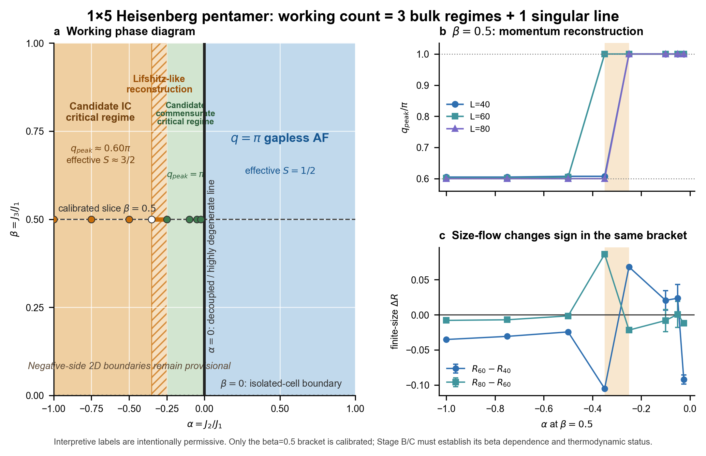

# 1×5 Heisenberg 五聚体：失败原因、候选相数与工作相图

更新时间：2026-08-12

## 结论

R17 的数值失败不能解释为“没有新相”。失败发生在 `alpha=-0.025, beta=0.5, L=40` 的收敛验收：两种初态的 `Sz=1` 方差/site 都是 `1.270800389×10^-8`，比预设的 `1×10^-8` 高约 27%。程序正常退出，远端与本地 checksum、能隙、截断误差、总 `Sz` 和 full-q 文件门均通过。R18 将预算提高到 128 sweeps 后已通过全部原门槛，并完成 checksum、非覆盖回传、独立 validator 和 accepted-only 接入。因此该失败已被证实为收敛预算不足，而不是相缺失或程序错误。

严格口径仍未确认第二个热力学相。采用作者允许的宽松解释后，当前最合理的工作计数是：**三个体相区，加一条奇异线**。

1. 深负 `alpha`：候选非公度临界区，`q_peak≈0.60pi`，有效块自旋约 `S≈3/2`。
2. 近零负侧：候选公度临界区，`q_peak=pi`。
3. 正 `alpha`：`q=pi` 无隙反铁磁临界区，有效五聚体双重态 `S=1/2`。
4. `alpha=0`：解耦/高简并奇异线，不计作普通二维体相。

## 失败原因分层

| 层级 | 现象 | 判断 | 补救 |
|---|---|---|---|
| R17 数值收敛 | 两个初态的 `Sz=1` 方差/site 均为 `1.270800389×10^-8` | 仅比门槛高 27%；不是程序崩溃，也不是物理态分叉 | R18 使用 128 sweeps 严格通过；原门槛未降低 |
| R18 首次启动 | Windows CRLF 使远端 `sha256sum -c` 把文件名读成带 `\r` | 上传包格式问题；Julia 尚未启动，未污染物理结果 | 已改成 LF、重算包哈希并重新上传；物理参数未变 |
| R16 能量平台 | 三初态末步能量变化约 `4.60×10^-8`–`5.26×10^-8`，高于严格 `10^-8` | 核心门通过，三初态能量极差小于 `10^-6` | 只按批准的 `10^-7` 实用门作 L80 校准，并标记 `boundary_eligible=false` |

“判定不用特别严格”只作用于相区命名：允许把稳定的动量区间称作候选相区。它不用于修改方差、截断、`Sz`、checksum 或边界宽度等数值门。

## 已有物理证据

在已验收的 `beta=0.5`、`L=40/60/80` 数据中：

- `alpha=-1.0,-0.75,-0.5` 的三种尺寸都给出 `q_peak/pi≈0.60`，尺寸漂移不超过 `0.0075`。
- `alpha=-0.25,-0.10,-0.05` 的可用尺寸给出 `q_peak/pi=1`。
- `alpha=-0.025` 已补齐三尺寸；R18/R19 均严格通过，`L=60/80` 给出 `q_peak/pi=1`，主导比值分别为 `0.0229811(4)` 与 `0.0109258(5)`。
- `alpha=-0.35` 的峰位对尺寸敏感，`L=40/80` 偏向 `0.60pi`，`L=60` 偏向 `pi`。
- `R60-R40` 在 `[-0.35,-0.25]` 两端反号；主峰也在同一区间重构。
- 该区间当前宽度为 `0.10`，尚未达到预设的 `0.025` 最终边界精度，因此严格称为“候选 Lifshitz 动量重构带”。

这些证据足以支持“负 alpha 存在不同于正区的候选物理区间”，但还不足以证明 `q≈0.60pi` 与 `q=pi` 两侧一定由热力学相变分隔。它们也可能是同一无隙临界相中的 Lifshitz 交叉。

## 物理图像

每个晶胞有五个自旋 `1/2`，总计为半奇整数自旋。只要平移和自旋旋转对称性保持，Lieb–Schultz–Mattis 型约束使“唯一、平庸、完全有隙”的基态不自然，因此大范围无隙临界行为是合理的。

正 `alpha` 下，反铁磁内部耦合把五聚体低能空间压到有效 `S=1/2` 双重态；晶胞间反铁磁耦合形成以 `q=pi` 为主的有效自旋链。

深负 `alpha` 下，铁磁 `J2` 倾向把部分局域自旋合成为更大的有效矩，强耦合图像给出约 `S≈3/2` 的低能块。它与剩余反铁磁键竞争后，相关峰移到约 `3pi/5`，并伴随弦/边缘诊断活跃，因此可暂称候选非公度临界区。

靠近 `alpha=0^-` 时，铁磁复合变弱，`q=pi` 重新占优。`alpha=0` 本身把部分耦合切断，产生解耦三聚体与跨胞二聚体的高简并结构，所以这条线可把正负两侧的有效低能描述分开，即使两侧都出现 `q=pi`。

## 工作相图的解释

图 a 给出宽松命名的三相区工作图；图 b 显示 `beta=0.5` 的主峰从约 `0.60pi` 重构到 `pi`；图 c 显示有限尺寸流在同一参数带变号。负 alpha 区在其他 beta 上尚未完成二维扫描，所以竖向延伸只是待检验假说，不是已经测得的边界曲线。

## 接下来如何把工作相图升级为论文相图

1. R18/R19 已严格通过并完成 Stage A：控制器 `16/0/0`，L80 校准共 8 点。
2. Stage B 已于 2026-08-12 08:17 CST 启动，在六个其他 beta 切片做负 alpha 粗扫，判断 `[-0.35,-0.25]` 重构带是否连续存在及是否弯曲；96 cells 单并发，条件 ETA 为 18–32 小时。
3. Stage C 只细化显著 bracket 到 `Delta alpha<=0.025`，并在最终 L60/L80 上复验。
4. 以 `q_peak` 加第二诊断（有限尺寸 `R` 流、弦序、能隙或纠缠）共同命名相；若只看到连续峰位移动，就将其写成 Lifshitz 交叉而非新热力学相。
5. Stage D 合并正区 105 条 accepted 记录，生成最终 source manifest、图件与 HTML。

本地终态链已在 2026-08-12 完成预检：Stage B 的 R19 释放门、Stage C 全通过/首失败组装、`0.05 -> 0.025` 再二分、后续轮次离线包、Stage D accepted-only 合并，以及 SVG/PDF/PNG/TIFF 与 figure QA 均有独立合成测试。剩余工作是用真实 R19、Stage B/C 回传替换合成输入；合成结果不作为物理证据。

## 当前可用于文章的表述

> 在 `beta=0.5` 切片上，五聚体链显示从深负 `alpha` 的非公度 `q≈0.60pi` 关联区到近零负侧 `q=pi` 关联区的清晰动量重构。该重构被 `L=40,60,80` 的主峰位置和有限尺寸比值流共同定位在 `alpha∈[-0.35,-0.25]`。现有证据支持将两侧视为不同的候选临界区，但尚不能排除同一无隙相内部 Lifshitz 交叉的解释。
